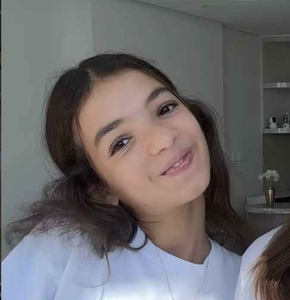

# Creative Corner

A family-supported creative notebook with example prompts for stories, art, and
small discoveries. The page uses sample content that can be replaced with
projects approved for sharing.



## Example ideas

- **Story starters** — invent a character, a place, and a surprising problem.
- **Color and shapes** — try a palette, pattern, or sketch.
- **Things to learn** — collect questions and small discoveries.

These are generated examples, not claims about personal interests or finished
work. The site does not publish an age, school, precise location, or personal
contact and social-media details. A parent reviews what is shared.

## Family site

The family website is managed by [Khadija Chahmoud](https://khadijachahmoud.github.io/).

## Run locally

```bash
npm ci
npm run dev
```

Create a production build with `npm run build`.

The site shares its layout and basic accessibility features with the family
website while keeping its own example content and portrait.
